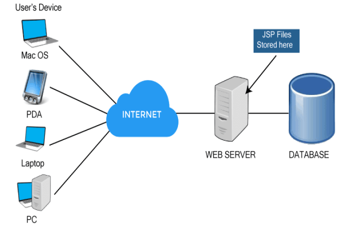
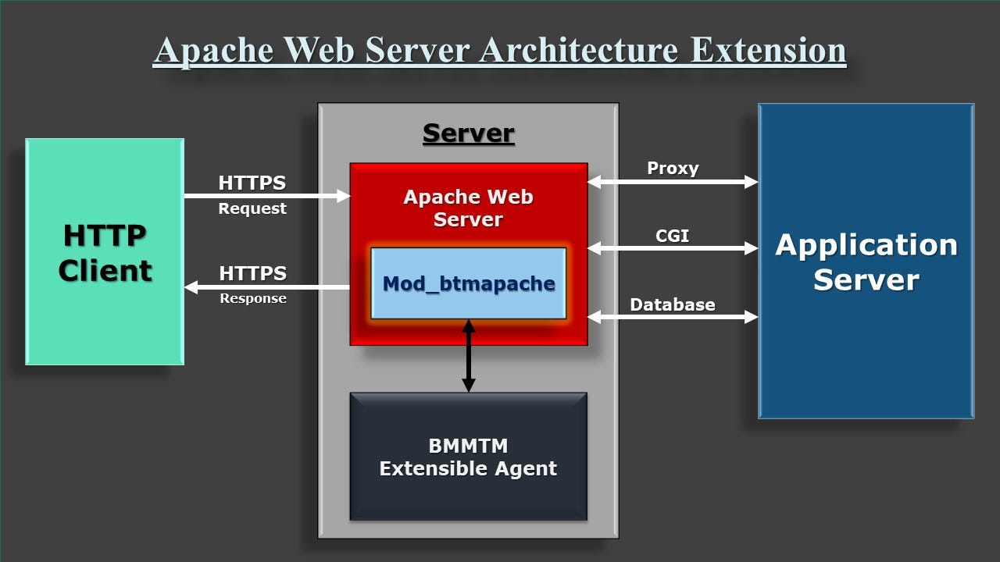
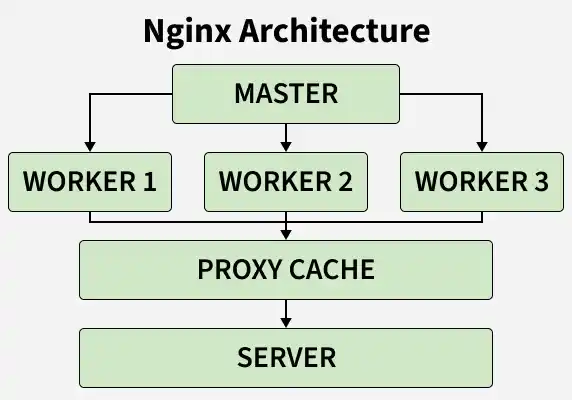
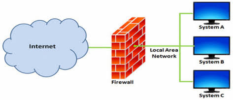

# Deliverable 1

## Questions


### 1. What is a web server?



A **web server** is software that receives requests from web browsers and sends back website content, such as web pages, images, and files. For example, when someone visits a website, the browser sends a request to the web server, and the server responds with the requested content.

### 2. What are some different web server applications?

#### Application 1: Apache HTTP Server



Apache HTTP Server is a free, open-source web server developed by the Apache Software Foundation. It is used to host websites and deliver web content to users.

* Website: [Apache HTTP Server](https://httpd.apache.org/)
* Available for: Linux, Windows, macOS, and other Unix-like operating systems.
* Latest version: Check the [official download page](https://httpd.apache.org/download.cgi) for the current release.

#### Application 2: Nginx



Nginx is an open-source web server known for handling many simultaneous connections efficiently. It can also work as a reverse proxy and load balancer.

| Website | Availability | Latest version |
| --- | --- | --- |
| [Nginx](https://nginx.org/en/download.html) | Linux, Windows, and other Unix-like systems | See the [official download page](https://nginx.org/en/download.html) |

#### Application 3: Microsoft Internet Information Services (IIS)

Microsoft IIS is a web server developed by Microsoft. It is used to host websites and web applications, especially on Windows-based servers.

* Website: [Microsoft IIS](https://www.iis.net/)
* Available for: Windows and Windows Server.
* Latest version: IIS 10.0. The available features depend on the Windows version.

#### Application 4: Caddy

Caddy is an open-source web server known for its simple configuration and automatic HTTPS support. It can automatically obtain and renew TLS certificates for supported websites.

* Website: [Caddy](https://caddyserver.com/)
* Available for: Linux, Windows, macOS, and other supported platforms.
* Latest version: Check the [official download page](https://caddyserver.com/download) for the current release.

### 3. What is virtualization?

**Virtualization** is a technology that allows one physical computer to run multiple virtual computers or operating systems. It uses software to create virtual versions of computer hardware, so users can run different operating systems on the same physical machine.

For example, a computer running Windows can use virtualization software to run a Debian Linux virtual machine.

### 4. What is VirtualBox?

**VirtualBox** is a virtualization application developed by Oracle. It allows users to create and run virtual machines on a physical computer. For example, you can install VirtualBox on your computer and use it to run Debian Linux without replacing your main operating system.

* Website: [Oracle VirtualBox](https://www.virtualbox.org/)
* Available for: Windows, macOS, Linux, and Oracle Solaris hosts.

### 5. What is a virtual machine?

A **virtual machine (VM)** is a software-based computer that behaves like a physical computer. It has virtual hardware, such as a processor, memory, storage, and a network adapter. A virtual machine can run its own operating system and applications.

For example, Debian Linux can run inside a virtual machine while the physical computer continues running Windows.

### 6. In the context of virtualization, what does host machine and guest machine mean?

* **Host Machine:** The host machine is the physical computer that runs the virtualization software. It provides the physical resources, such as the CPU, RAM, storage, and network connection.

* **Guest Machine:** The guest machine is the virtual computer created inside the host machine. It uses virtual hardware and runs its own operating system.

For example, if your physical computer runs Windows and VirtualBox runs Debian Linux inside it, Windows is the host operating system and Debian is the guest operating system.

### 7. What is Debian?

Debian is a free, open-source operating system based on the Linux kernel. It is maintained by a community of developers and is known for stability and reliability. Debian is commonly used on servers, desktop computers, and virtual machines.

Debian uses the APT package manager to install and update software. For example:

```bash
sudo apt update
sudo apt upgrade
sudo apt install apache2
```

* Website: [Debian](https://www.debian.org/)
* Latest stable version: Check the [Debian website](https://www.debian.org/) for the current stable release.

### 8. What is a firewall?



A **firewall** is a security system that monitors and controls incoming and outgoing network traffic. It follows configured rules to allow or block connections. A firewall helps protect computers and networks from unauthorized access and unwanted network traffic.

For example, a firewall can allow normal web traffic while blocking an unapproved connection to a computer.

### 9. What is SSH?

**SSH (Secure Shell)** is a network protocol that allows a user to securely connect to and manage another computer over a network. The connection is encrypted, which helps protect the information being transmitted.

SSH is commonly used by administrators to manage Linux servers remotely.

```bash
ssh username@192.168.1.100
```

The command connects to the computer at `192.168.1.100` using the specified username. The default SSH port is **22**.

### 10. What is an IP Address?

An **IP (Internet Protocol) address** is a numerical address assigned to a device on a network. It identifies the device and allows it to communicate with other devices.

There are two main versions:

* **IPv4:** Uses a 32-bit address, usually written as four numbers separated by periods. Example: `192.168.1.100`.
* **IPv6:** Uses a 128-bit address written in hexadecimal groups. It provides a much larger address space than IPv4.

### 11. What is a network mask?

A **network mask**, also called a subnet mask, identifies which part of an IPv4 address represents the network and which part identifies the host (device) on that network.

For example:

```text
IP Address:  192.168.1.100
Subnet Mask: 255.255.255.0
```

With this subnet mask, `192.168.1` is the network portion and `100` is the host portion. The mask helps a device determine whether another IP address is on its local network.

### 12. What is a port? (In the context of networking/computers)

A **port** is a numbered communication endpoint used by a computer to direct network traffic to the correct application or service. An IP address identifies the device, while the port number helps identify the service on that device.

Some common port numbers are:

| Port | Service | Purpose |
| --- | --- | --- |
| 21 | FTP | File transfers |
| 22 | SSH | Secure remote access |
| 25 | SMTP | Sending email |
| 53 | DNS | Domain name resolution |
| 80 | HTTP | Web traffic |
| 443 | HTTPS | Secure web traffic |

Port numbers range from **0 to 65535**.

### 13. What is port forwarding?

**Port forwarding** is a router configuration that directs incoming network traffic on a particular port to a specific device inside a private network.

For example, if you host a web server on a computer at `192.168.1.100`, you can configure your router to forward incoming traffic on port 80 to that computer. This can allow people outside your home network to reach the web server.

Port forwarding should be configured carefully because it can make an internal service accessible from the internet.

### 14. What is localhost? (In the context of networking/computers)

**Localhost** is a hostname that refers to the computer you are currently using. It is commonly used when testing applications or services running on the same computer.

For example, if a web server is running on your computer, you can enter the following address in a browser to access it locally:

```text
http://localhost
```

### 15. What does this IP address represent: 127.0.0.1?

**127.0.0.1** is the IPv4 loopback address. It refers to the local computer, so network traffic sent to this address is directed back to the same computer instead of another device.

It is often used to test the computer's local networking functions.

```bash
ping 127.0.0.1
```

This command tests communication with the local computer's network stack.

### 16. What is Git?

**Git** is a free, open-source version control system. It tracks changes made to files, especially source code, and allows users to return to earlier versions of a project.

Git is useful when working alone or with a team because it keeps a history of changes.

Some common Git commands are:

```bash
git init
git add .
git commit -m "Initial commit"
git status
git log
```

* Website: [Git](https://git-scm.com/)

### 17. What is GitHub?

**GitHub** is an online platform for hosting and managing Git repositories. It allows developers to store projects online, share code, work together, review changes, and track project issues.

Git and GitHub are related, but they are not the same:

* **Git** is the version control tool used to track changes.
* **GitHub** is an online service that hosts Git repositories and provides collaboration tools.

* Website: [GitHub](https://github.com/)


## Topics I Did Not Understand

### 1. Systemctl

Systemctl is a Linux command used to manage and check system services. It allows users to start, stop, restart, enable, and check the status of services running on a Linux computer.

Example:
```bash
systemctl status apache2
```
This command checks whether the Apache web server is running.

### 2. SCP (Secure Copy Protocol)

SCP is a command-line tool used to securely transfer files between computers over an SSH connection. It is useful when uploading files from a host machine to a remote Linux server.

Example:
```bash
scp file.txt username@192.168.1.100:/home/username/
```
This command copies a file from the local computer to a remote computer.

### 3. UFW (Uncomplicated Firewall)

 UFW is a firewall management tool for Linux that makes it easier to configure network security rules. It allows users to control which network connections are permitted or blocked.

Example:
```bash
sudo ufw allow 22
```
This command allows incoming SSH connections through port 22.

### 4. NAT (Network Address Translation)

NAT is a networking method that allows a private network or virtual machine to access the internet through another device's network connection. In VirtualBox, NAT allows a guest machine to use the host machine's internet connection without being directly accessible from other computers on the network.

### 5. Bridge Network Adapter

 A Bridge Network Adapter is a VirtualBox networking option that connects a virtual machine directly to the same physical network as the host computer. This allows the virtual machine to receive its own IP address from the router and communicate with other devices on the network.

### 6. CIDR (Classless Inter-Domain Routing)

 CIDR is a method of representing IP addresses and their network masks using slash notation. The number after the slash represents how many bits of the IP address belong to the network portion.

Example:
```text
192.168.1.10/24
```
The `/24` means that the first 24 bits represent the network portion, while the remaining 8 bits represent the host portion.