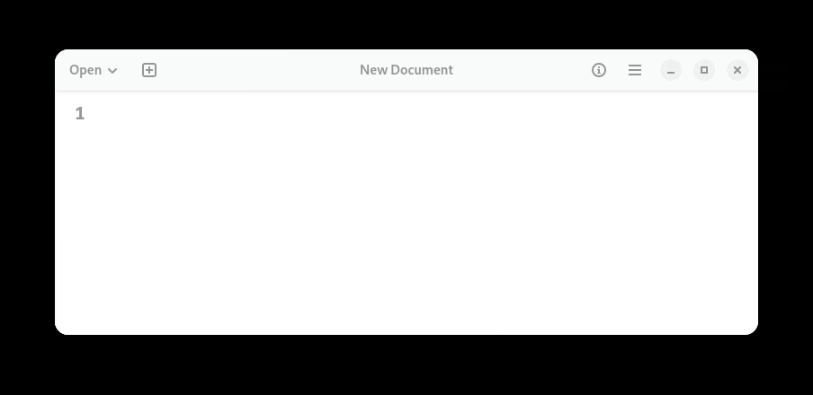

# Notes 4

## How to install and remove software using APT command.
APT (Advanced Package Tool) is used to search for, install, view documentation for, run, and remove software in Linux. First, the apt search "tetris clone" command searches for packages related to Tetris games, and the package tint is selected. The command sudo apt install tint installs the game. To read its manual, use man tint, and to start the game, enter tint in the terminal. After playing, use sudo apt remove tint to uninstall the game, then sudo apt purge tint to remove the package and its system configuration files if any remain.

command 1 - apt search "tetris clone"
command 2 - sudo apt install tint
command 3 - man tint
command 4 - tint
command 5 - sudo apt remove tint
command 6 - sudo apt purge tint

## How to create a shell script step by step including screenshots and how to run it. 
A shell script is a file that contains a series of Linux commands executed in sequence. It helps automate repetitive tasks. Shell scripts usually have the .sh extension and begin with the shebang #!/bin/bash, which tells Linux to use the Bash shell to execute the script.

## step 1 
open the terminal.

## step 2 
create a shell script. we can use text editor to create a new file.

## step 3
 write the script.

## step 4 
save the file.

## step 5 
give execution permission. Before running the script, make it executable.

## step 6 
Run the shell script.

## step 7 
View the output.

