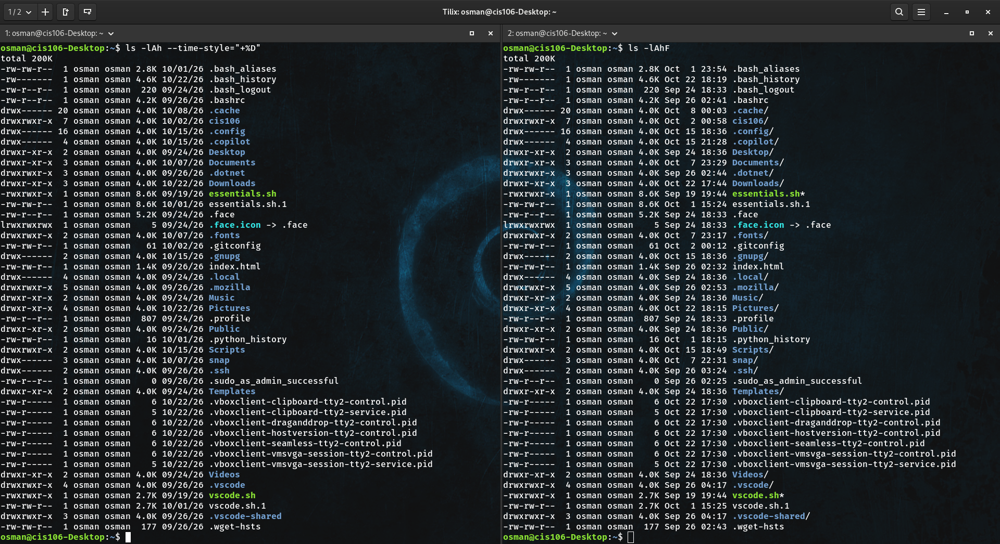
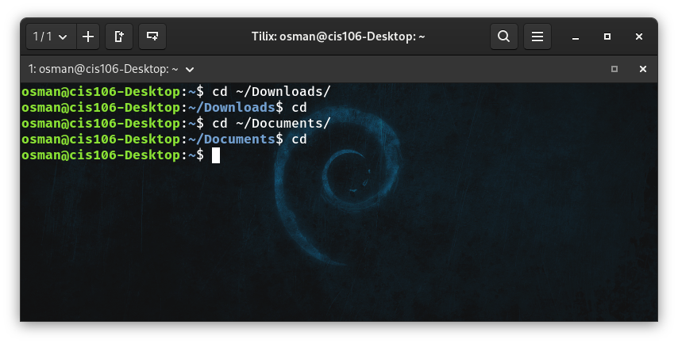

# Notes 5

## LS

- **Usage**
  - `ls` is used for listing files and directories. By default, it lists the current directory when no directory is specified.

- **Formula**
  - `ls + option + directory to list`

- **Examples**
  - See all the options of the `ls` command:
    - `ls --help`
  - List the current directory:
    - `ls`
  - List all files, including hidden files:
    - `ls -a`

## PWD

- **Usage**
  - `pwd` is used to print the full path of the current working directory.

- **Formula**
  - `pwd`

- **Examples**
  - Display the current directory:
    - `pwd`

## CD

- **Usage**
  - `cd` is used to change directories.

- **Formula**
  - `cd + directory`

- **Examples**
  - Change to the Documents directory:
    - `cd Documents`
  - Move up one directory:
    - `cd ..`
  - Go to the home directory:
    - `cd ~`

## a. What is a variable?
- A variable is a named storage location used to store information or data.

## b. How Do I Use a Variable?
- A variable is used by assigning a value to a name and referencing it using `$` followed by the variable name.

## c. What is an environment variable?
- Environment variables store information about the system environment and can be accessed by programs and processes.

## d. What is a user defined variable?
- User-defined variables are created by users to store information for use in commands or scripts.

## e. What is the root directory?
- The root directory is the top-level directory in the Linux file system, represented by `/`.

## f. What does “Parent Directory” mean?
- A parent directory is the directory that contains another directory or file.

## g. What does “Current working directory” mean?
- The current working directory is the directory you are currently working in within the file system.

## h. What is an absolute path? Include an example
- An absolute path is the complete path to a file or directory starting from the root directory (`/`).
- **Example:** `/home/student/Documents/notes.txt`

## i. What is a relative path? Include an example
- A relative path is a path to a file or directory based on the current working directory.
- **Example:** `Documents/notes.txt`

## j. What is the difference between “Your home directory” and “The home directory”?
- **Your home directory:** The personal directory assigned to your user account, usually `/home/username`.
- **The home directory:** The `/home` directory that contains the personal directories of regular users.

