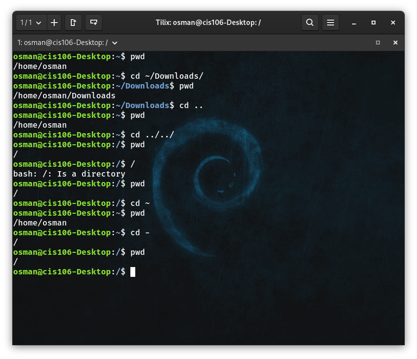
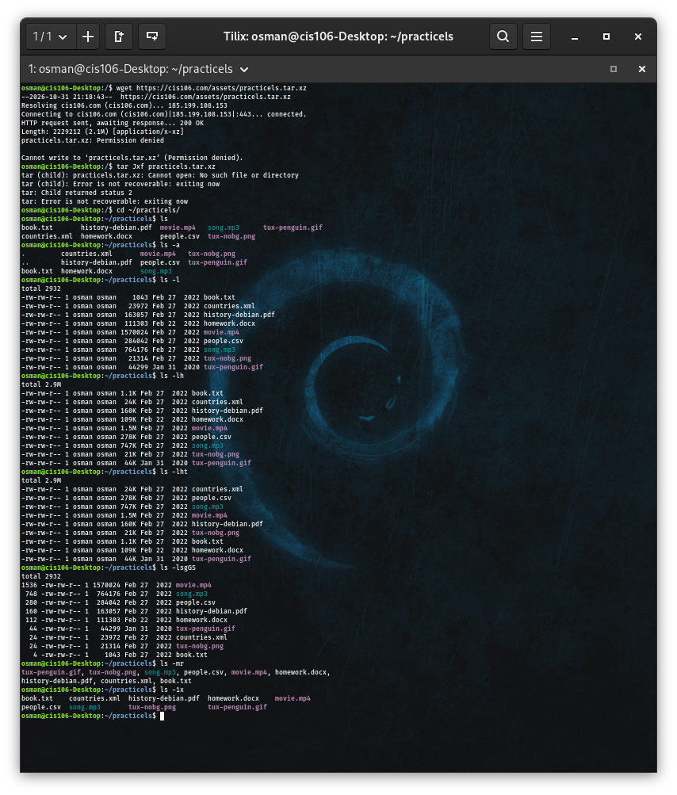
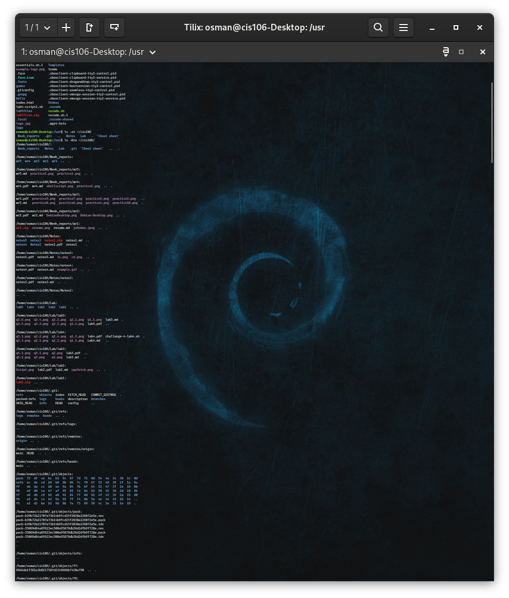
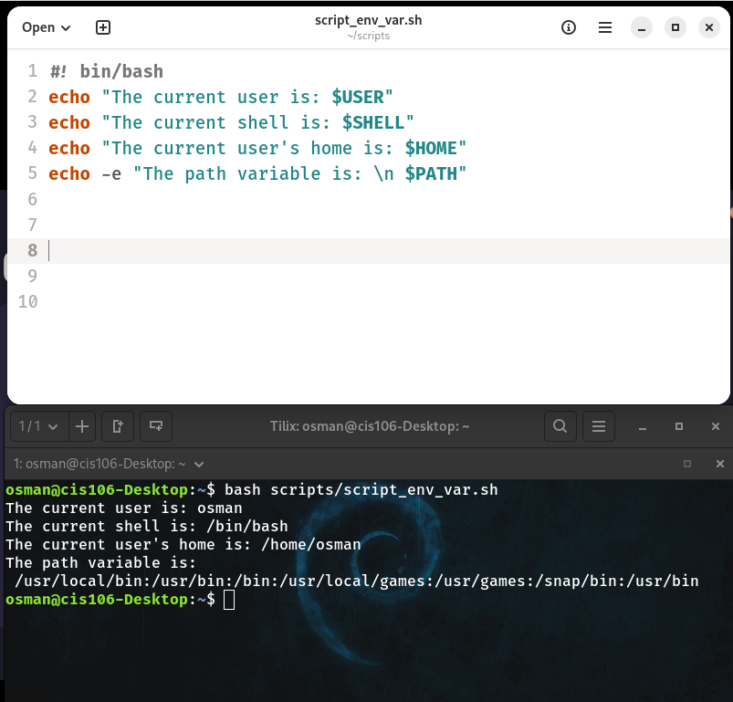
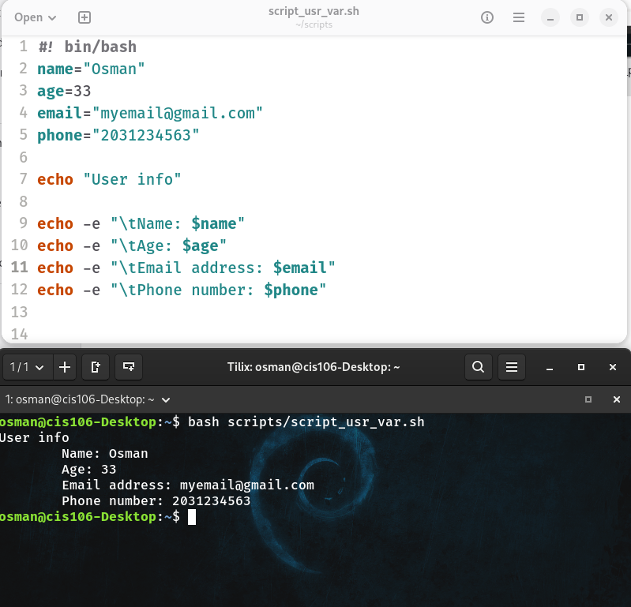

# Week report 5

* [Lab5](../../Lab/lab5/lab5.md)
* [notes5](../../Notes/notes5/notes5.md)

## The Linux Filesystem:
## practice 1

## Practice 2

## practice 3

## Shell Scripting Chapter 2

## practice 2

## practice 3
